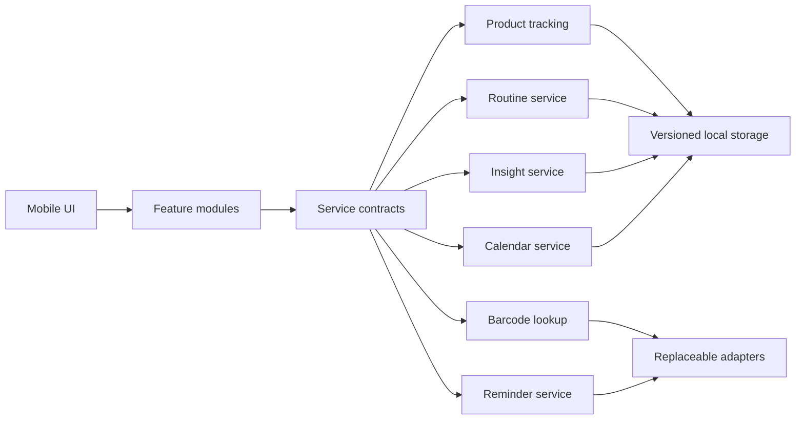

<div align="center">

# ◒ ShelfCare

### Know what you own. Use what you love.

A calm, mobile-first companion for makeup, skincare, routines, and better beauty habits.


</div>

---

## What is ShelfCare?

**ShelfCare** is a play on *self care*: “shelf” represents the products a person already owns, while “care” represents the routines and habits built around them.

The app brings product tracking, expiry awareness, daily skin notes, and routines into one friendly space. It is designed to help people buy more thoughtfully, use products before they expire, and understand what works for their skin over time.

## Highlights

| | Feature | What it does |
|---|---|---|
| 📦 | **Beauty shelf** | Organises skincare, makeup, haircare, and bodycare in cards or a compact list. |
| ▥ | **Barcode lookup** | Prefills product details from a scanned barcode, with manual entry as a fallback. |
| ◷ | **Expiry awareness** | Surfaces products that need attention and supports reminder preferences. |
| ✦ | **Daily check-ins** | Records skin condition, mood, products used, routine progress, and notes. |
| ✓ | **Routine builder** | Adds, edits, reorders, and completes up to 15 routine steps. |
| ♡ | **Insight notebook** | Saves useful daily insights for later reference. |
| ◫ | **Calendar history** | Makes day-to-day changes visible through seeded diary history. |
| ⇩ | **Local data export** | Downloads a portable JSON backup containing only ShelfCare data. |

## Product principles

- **Local-first:** every core feature works without creating an account.
- **Clear consent:** account creation is presented as an optional path to future cross-device sync.
- **Low-friction:** quick actions keep scanning, adding products, and daily logging close at hand.
- **Accessible:** visible focus states, readable contrast, labelled controls, and keyboard alternatives accompany touch gestures.
- **Resilient:** storage is versioned, service operations return typed results, and limits are enforced in both the interface and service layer.

> [!NOTE]
> The current build stores data in the browser. Account and sync screens establish the intended experience, but a production authentication and cloud database provider still needs to be connected for real cross-device sync.

## Design language

ShelfCare uses warm, low-saturation colours with charcoal text and restrained elevation. Oat Inktrap gives headings personality; Lora keeps longer text comfortable to read.

| Token | Colour | Use |
|---|---|---|
| Soft Pink | `#F8EDEB` | Page foundation |
| Blush Pink | `#F6D6CF` | Interactive cards and selected states |
| Peach Orange | `#F6CAA0` | Highlights and calls to action |
| Cream Orange | `#F4DCC7` | Information surfaces |
| Paper | `#F9F9F9` | Inputs and raised content |
| Charcoal | `#383838` | Primary text and icons |

## Architecture

ShelfCare follows a **ports-and-adapters** structure. Each major capability owns a service contract, and feature components depend on those contracts rather than concrete storage implementations.



This keeps product tracking, scanning, routines, reminders, insights, calendar history, ingredients, and community concerns independently replaceable. The current adapters are local implementations; remote services can be introduced behind the same contracts.

### Project map

```text
app/
├── page.tsx                 # composition and mobile application shell
├── globals.css              # ShelfCare design system and responsive styles
└── manifest.ts              # installable-app metadata

src/
├── core/                    # typed result and error primitives
├── domain/                  # shared models and domain limits
├── features/                # isolated feature UI and hooks
├── platform/                # versioned browser storage
├── services/
│   ├── contracts.ts         # ports between features and infrastructure
│   ├── container.ts         # composition root
│   └── local/               # local service adapters
└── ui/                      # reusable interface assets

tests/                       # rendering, boundary, privacy, and invariant tests
```

## Getting started

### Requirements

- Node.js `22.13.0` or newer
- npm

### Run locally

```bash
git clone https://github.com/hazelhidayah/ShelfCare.git
cd ShelfCare
npm install
npm run dev
```

Open [http://localhost:3000](http://localhost:3000).

### Quality checks

```bash
npm run lint
npx tsc --noEmit
npm test
npm audit --omit=dev
```

`npm test` creates a production build before running the architecture and rendered-output checks.

## Data and privacy

Local data is stored under namespaced `shelflife.*` browser-storage keys for compatibility with earlier prototypes. Exporting data collects only keys inside that namespace; unrelated browser data is excluded.

The export includes:

- beauty products and favourites;
- routine steps and completion state;
- calendar check-ins;
- saved insights;
- profile and account-mode preferences.

Removing browser storage removes local-only ShelfCare data, so local users should export a backup before clearing their browser or changing devices.

## Reliability safeguards

- Versioned storage envelopes reject incompatible saved data safely.
- Runtime guards validate products, routines, and calendar records.
- Feature modules cannot instantiate concrete adapters directly.
- Routine length is capped at 15 in both UI and service validation.
- Destructive routine actions keep at least one step.
- Product images have graceful fallbacks when a remote image fails.
- Service errors are shown with retry paths where recovery is possible.
- Production dependencies currently pass `npm audit --omit=dev` with zero known vulnerabilities.

## Roadmap

The next major ShelfCare update is a dedicated **Community** tab, making shared routines, product experiences, and recommendations easier to discover.

Future work also includes:

- production authentication and encrypted cloud sync;
- real barcode/product catalogue integrations;
- push notifications for expiry and routine reminders;
- backup import and account migration;
- expanded accessibility and device testing;
- optional personalised recommendations with transparent controls.

---

<div align="center">

Built around a simple idea: a kinder beauty routine starts with caring for what is already on your shelf.

</div>
